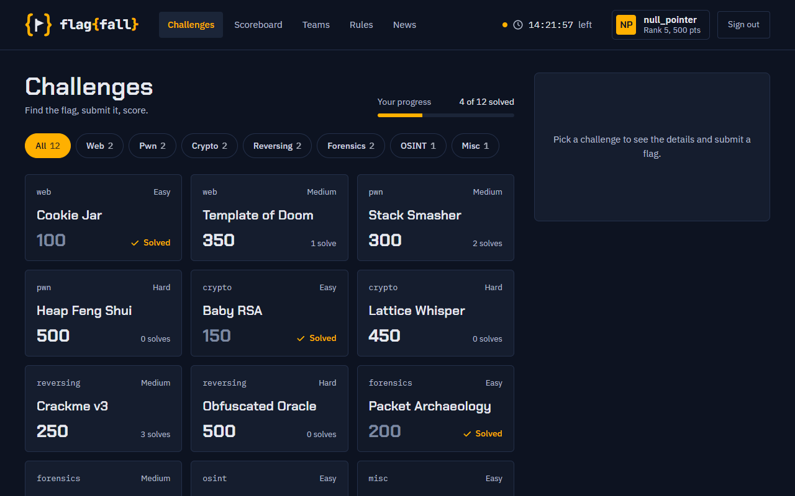
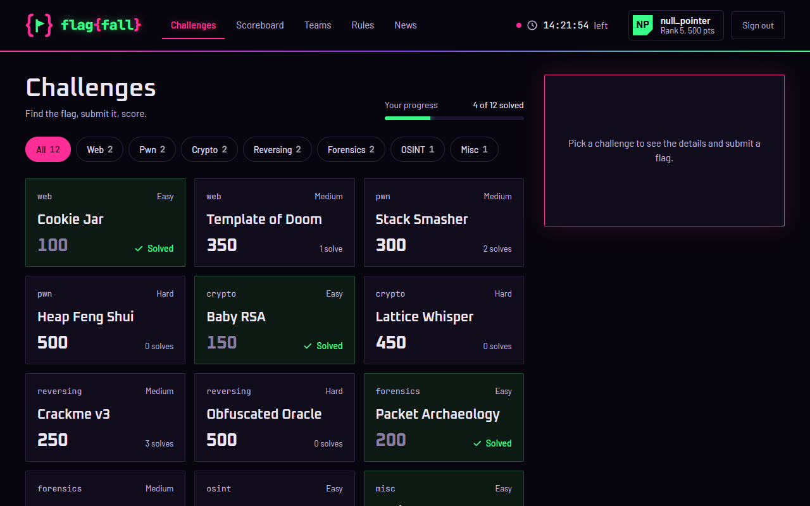
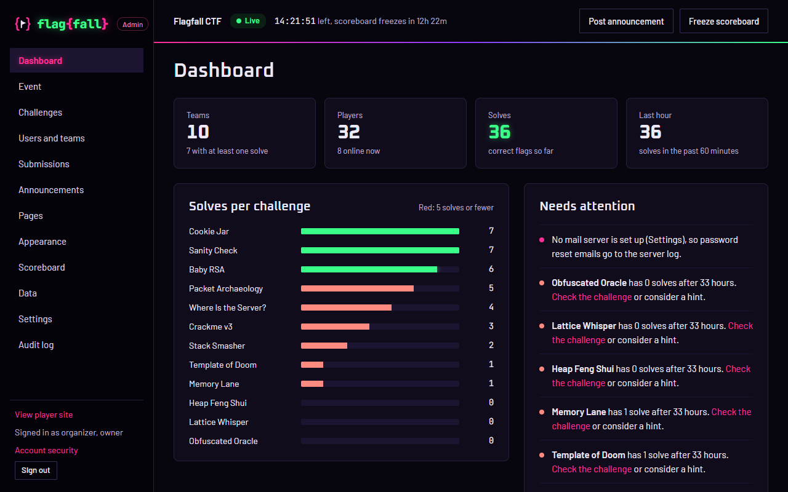

# Flagfall

**A free, self-hosted CTF platform you can run anywhere and re-skin without code.**

> **Status: pre-alpha.** The platform, admin panel and two themes work end to end; packaging and more themes are in progress (Phase 3). Nothing is released yet. See [PLAN.md](PLAN.md) for the roadmap and [flagfall-master-plan.md](flagfall-master-plan.md) for the full design.

- **Run anywhere.** One binary or one container. SQLite by default, PostgreSQL for big events. Works offline, so it also runs on air-gapped training networks.
- **Re-skin without code.** Pick a theme in the admin panel, change its colors, logo and wording, preview it on live data, publish.
- **Challenges as files.** Each challenge is a `challenge.yml` you can keep in git and import in one step.
- **Fair play built in.** Per-team flags, alerts for shared flags and suspicious solves, and optional two-factor sign-in for staff.

## Try it in 60 seconds

You need [Docker](https://docs.docker.com/get-docker/) with Compose.

```sh
git clone https://github.com/flagfall/flagfall
cd flagfall
docker compose up --build -d
```

Open http://localhost:8090 when the build finishes (the first one takes a few minutes; later starts take seconds). This starts a sample event with 12 challenges and 10 teams. The sign-in page has two demo buttons:

- **Player** signs you in as `kaito` on team `null_pointer`. Solve a challenge and watch the scoreboard.
- **Organizer** signs you in as the event owner. Open http://localhost:8090/admin to edit challenges, follow submissions, or switch the theme under **Appearance**.

`docker compose down -v` stops it and deletes the data. To run a real event on a public server with HTTPS, see [deploy/README.md](deploy/README.md).

## Themes

Themes change the whole player site, not just its colors, and the admin panel follows the published theme's palette. Two ship today; seven more are planned for 1.0.

| Amber Phosphor | Neon |
| --- | --- |
|  |  |
| A calm amber terminal. The default. | Hot pink and green on near-black, with a reduced-motion version. |



To build your own, copy `themes/starter` and read the [theme manifest](docs/dev/theme-manifest.md) and [SDK](docs/dev/sdk.md) docs.

## Developing

You need [Go 1.26+](https://go.dev/dl/), [Node 22+](https://nodejs.org/) and [pnpm 9](https://pnpm.io/).

```sh
pnpm install
pnpm -r build                    # themes and admin panel, embedded in the binary
go run ./cmd/flagfall seed sample   # optional: the sample event
make dev                         # or: go run ./cmd/flagfall serve
```

Then open http://localhost:8080. `make test` and `make lint` run everything CI runs. On Windows without `make`, run the `go` and `pnpm` commands from the [Makefile](Makefile) directly. Configuration is in [docs/dev/config.md](docs/dev/config.md).

## Repository layout

| Path | What's there |
| --- | --- |
| `cmd/flagfall/` | Command line: `serve`, `seed`, `backup`, `restore`, `migrate`, `challenges`, `version` |
| `internal/` | Server code |
| `migrations/` | Database migrations |
| `web/sdk/` | Theme SDK, published as `@flagfall/theme-sdk` |
| `web/admin/` | Admin panel |
| `themes/` | Bundled themes; `themes/starter` is the one to copy |
| `challenges/sample/` | 12-challenge starter pack |
| `deploy/` | Production Compose stack with Caddy, and deployment docs |
| `docs/` | Documentation; `docs/dev/` holds design docs |
| `design/` | Static design mockups the themes are built from (not shipped) |
| `e2e/` | Browser tests run against every bundled theme |
| `loadtest/` | Player simulator and load-test results |

## Contributing

Read [CONTRIBUTING.md](CONTRIBUTING.md). Theme pages are a great first contribution. Please follow the [Code of Conduct](CODE_OF_CONDUCT.md), and report security problems privately as described in [SECURITY.md](SECURITY.md).

## License

[Apache License 2.0](LICENSE). The Flagfall name and logo are covered by a separate trademark policy (to be published before 1.0).
